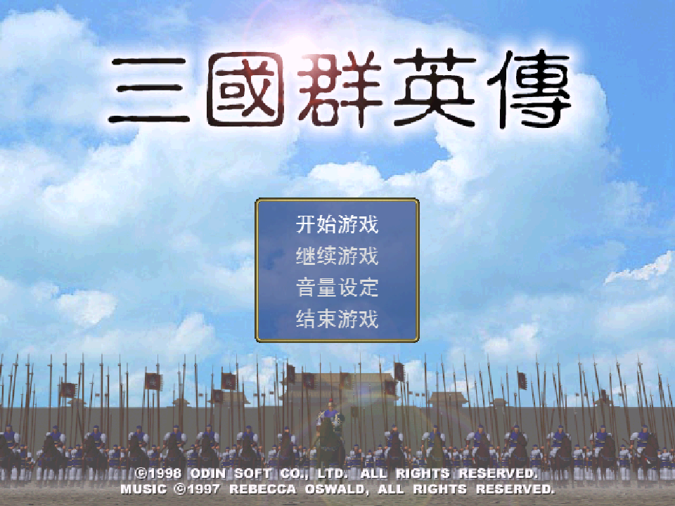
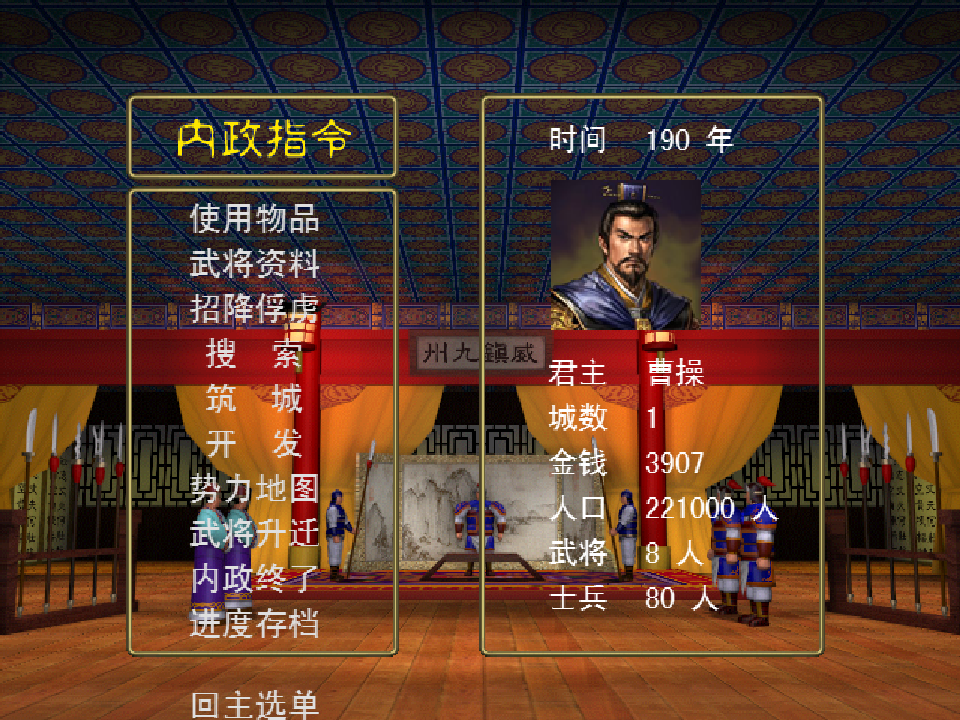
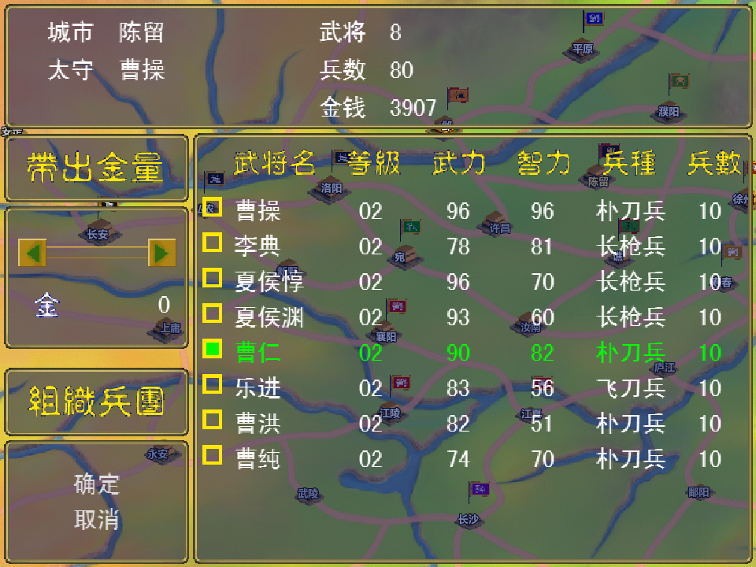
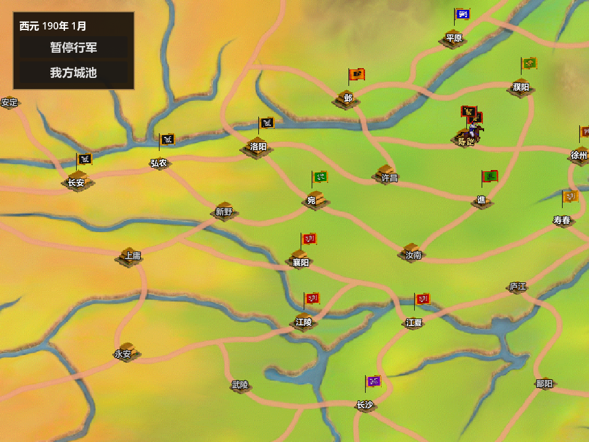
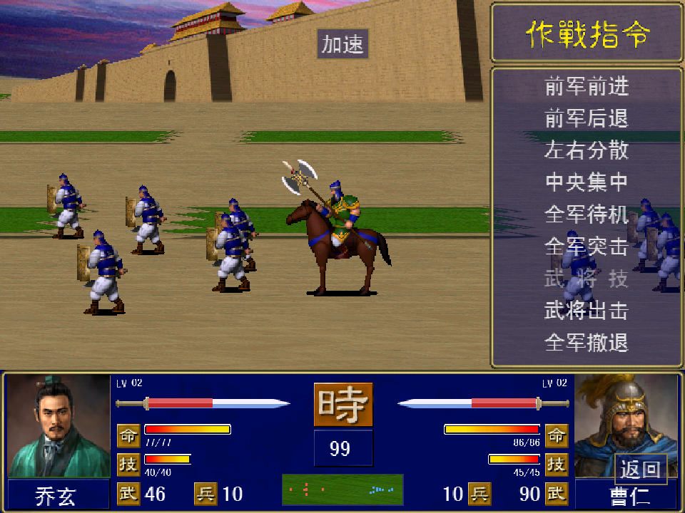
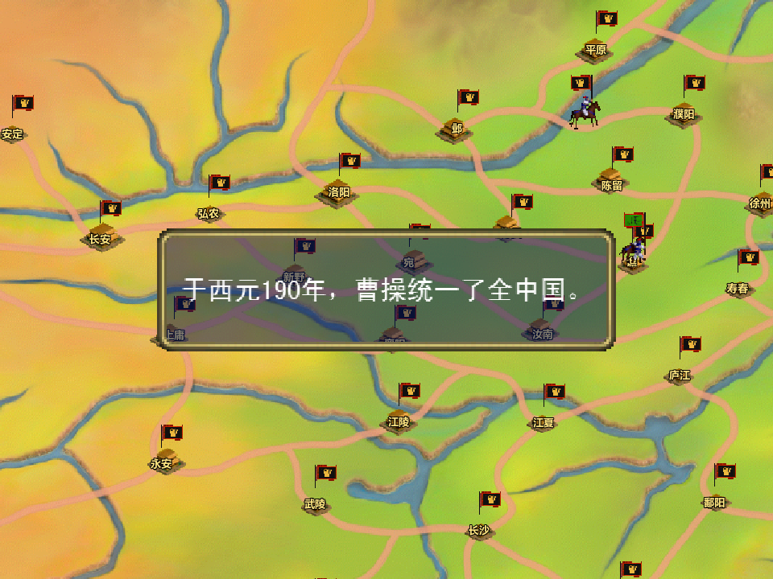

# 群英战记

《群英战记》是一款使用 Godot 和 GDScript 开发的三国策略游戏。玩家可以经营城池、招揽武将、组建部队，并在战略地图上行军和交战。

## 运行游戏

使用 **Godot 4.7** 标准版，已在 Windows 的 Godot 4.7.2 上测试。

```bash
git clone https://github.com/qiumozhou/three_kingdoms.git
cd three_kingdoms
```

在 Godot 项目管理器中导入根目录的 `project.godot`，等资源导入完成后按 **F5** 运行项目。也可以从仓库根目录运行：

```bash
godot --path .
```

## 190 年曹操剧本

1. 在标题界面选择「开始游戏」，选择曹操并确认。
2. 在内政界面可以搜索、筑城、开发、任命官职和管理武将。选择「内政终了」进入战略阶段。
3. 点击陈留，选择「部队出征」，勾选曹仁并确认，再在地图上点击濮阳。点击地图上的部队军旗可变更目的地、驻防或进入城内。
4. 到达濮阳后，在选将界面选择「出战」。开战对白结束后，从右侧作战指令发令。交战结束后按报告继续，回到战略地图。

## 游戏截图

以下画面均截自 Godot 运行中的游戏。

| 标题界面 | 190 年曹操内政 |
| --- | --- |
|  |  |

| 陈留出征编组 | 战略地图行军 |
| --- | --- |
|  |  |

| 濮阳战斗与作战指令 | 统一纪年 |
| --- | --- |
|  |  |

统一纪年截图来自最后一城验证用例，从已拥有 47 城的状态开始，并通过实际战斗攻下谯城。

## 测试

在项目根目录运行以下命令，可检查 190 年曹操开局、首战、跨年、电脑调兵和结局入口。首次运行时先导入资源。

```powershell
godot --headless --path . --import
Get-ChildItem tests/test_*.gd | ForEach-Object {
    godot --headless --path . --script "res://tests/$($_.Name)"
    if ($LASTEXITCODE -ne 0) { throw "测试失败：$($_.Name)" }
}
```

190 年曹操剧本已验证濮阳首战、撤退回图、跨年和被俘结局。胜利用例覆盖最后一城易主、统一纪年和滚动字幕。从开局自然攻取 48 城的完整验证仍待完成。
